# Credit Card Fraud Detection: Sampling Ratio & Model Comparison

A notebook-based comparative study on the European Credit Card Fraud dataset. The goal is not a deployed app, but to answer two questions:

1. **How does the undersampling ratio affect fraud detection?** (Original vs 20:1 vs 10:1 vs 5:1 vs 1:1 using `RandomUnderSampler`)
2. **Which classifier handles the imbalance best?** (Logistic Regression vs Decision Tree vs Random Forest)

Everything lives in [`fraud_detection.ipynb`](fraud_detection.ipynb).

## Dataset

- 284,807 transactions, 31 columns: `Time`, `Amount`, `V1`–`V28` (PCA-transformed) and `Class`
- 1,081 duplicate rows removed, leaving **283,726** transactions
- Extreme imbalance: **99.83% genuine vs 0.17% fraud** (473 fraud cases)
- Source: [Kaggle - Credit Card Fraud Detection](https://www.kaggle.com/datasets/mlg-ulb/creditcardfraud) (not included in the repo, see [`data/README.md`](data/README.md))

## Workflow

1. Data cleaning (missing values, duplicates)
2. Exploratory data analysis
3. Stratified 80/20 train-test split (`random_state=42`)
4. `StandardScaler` on `Time` and `Amount` (fit on train only)
5. Baseline Logistic Regression on the original imbalanced data
6. Undersampling ratio comparison with Logistic Regression
7. Model comparison at the chosen 20:1 ratio
8. ROC / Precision-Recall curves, feature importance, model saving with Joblib

Outliers in `Amount` (31,685 by the IQR rule) were deliberately **kept**, since unusual amounts can be exactly what fraud looks like.

---

## Exploratory Data Analysis

### Class imbalance
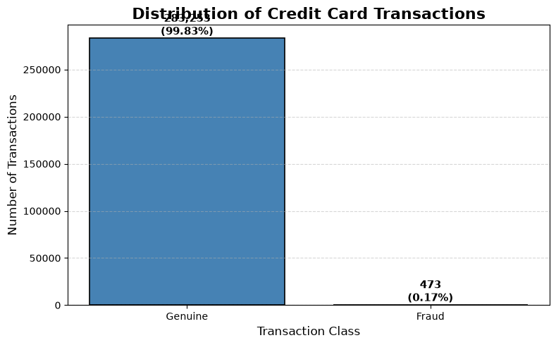

Accuracy alone is misleading here, since predicting "genuine" every time scores ~99.8%. That's why Precision, Recall, F1 and ROC-AUC are used throughout.

### Transaction amount by class
| Boxplot (log scale) | Violin plot (log scale) |
|---|---|
| 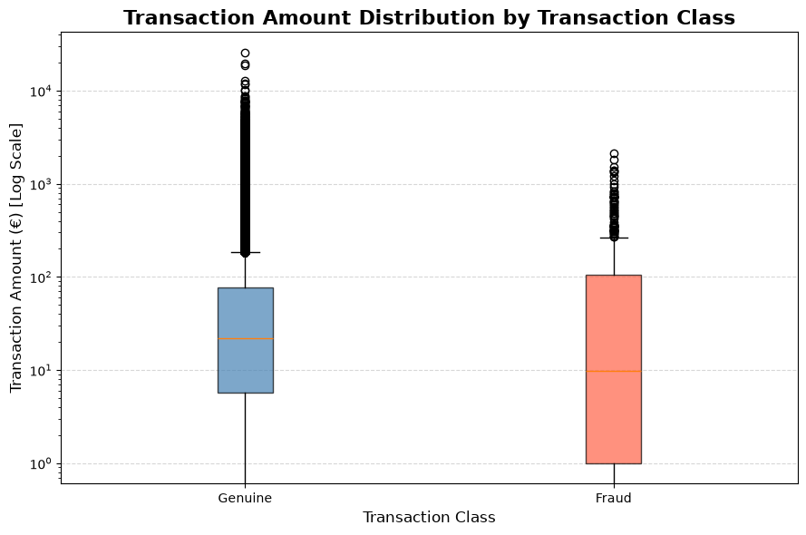 | 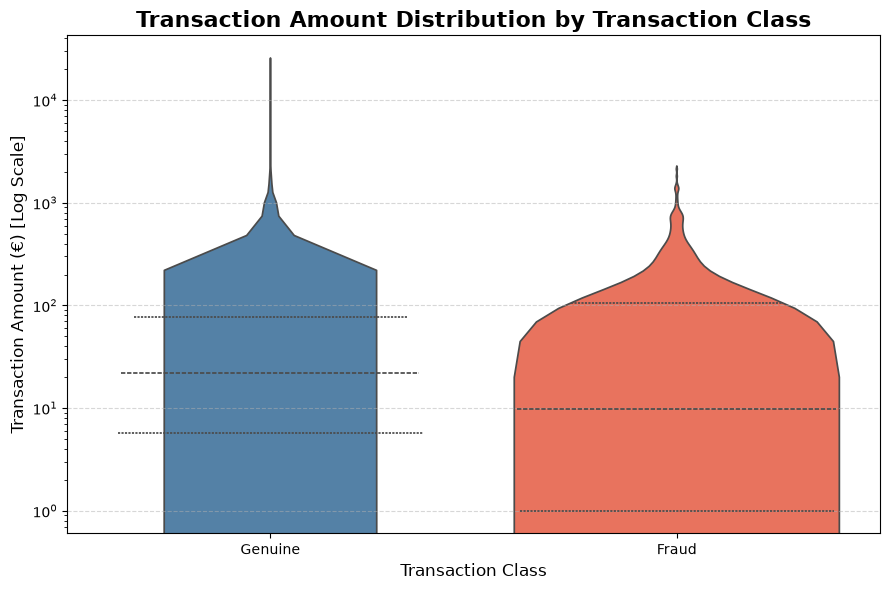 |

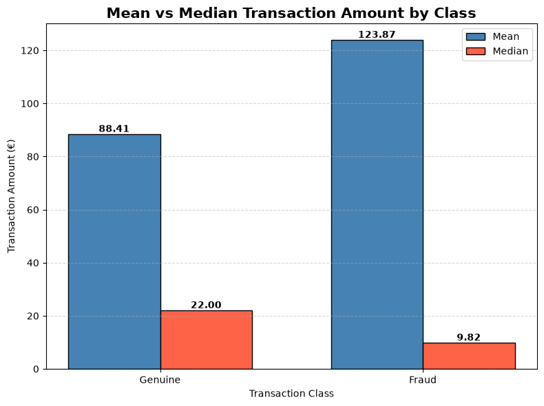

Amounts are heavily right-skewed and overlap between classes, so amount by itself cannot separate fraud from genuine.

### Transactions by hour
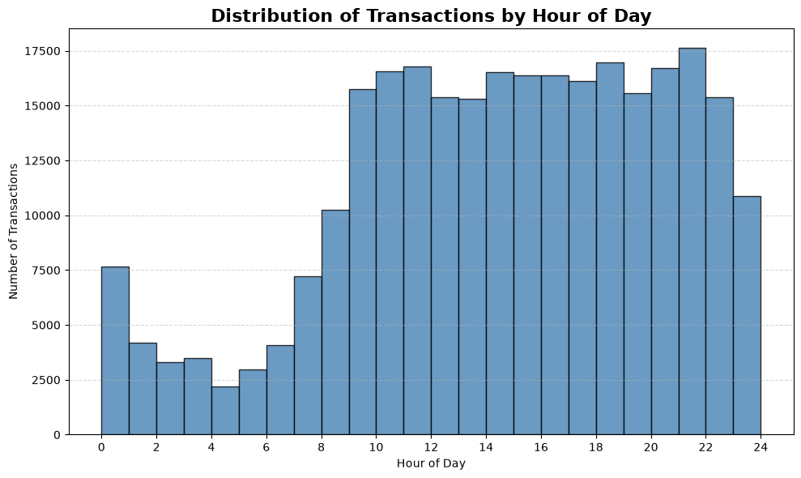

### Correlations
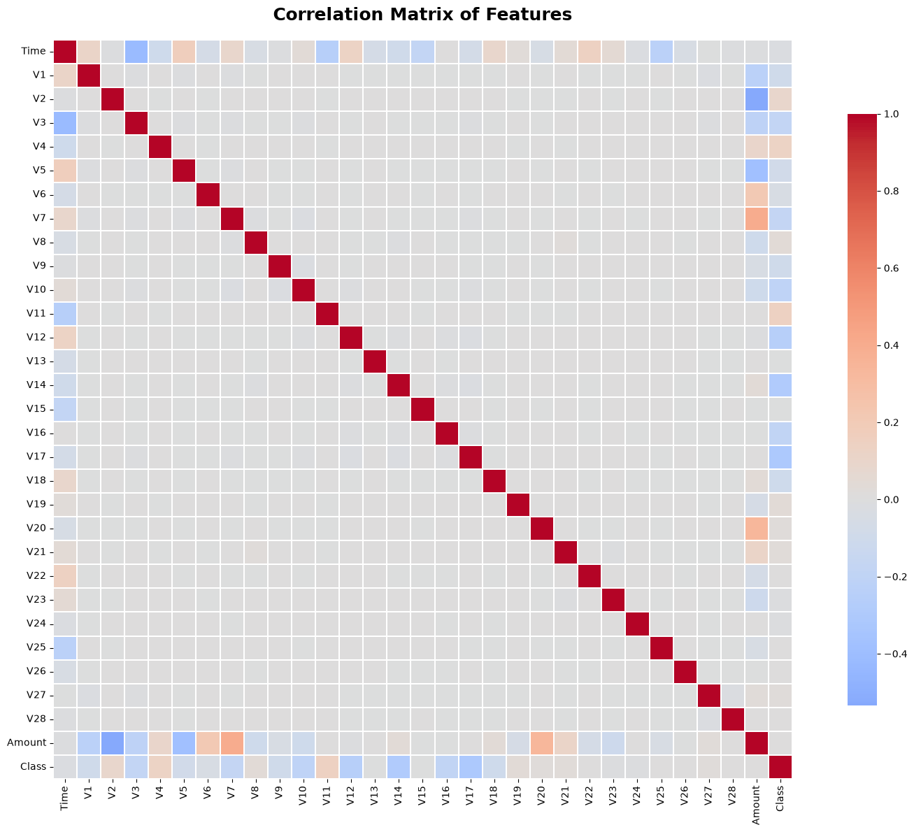

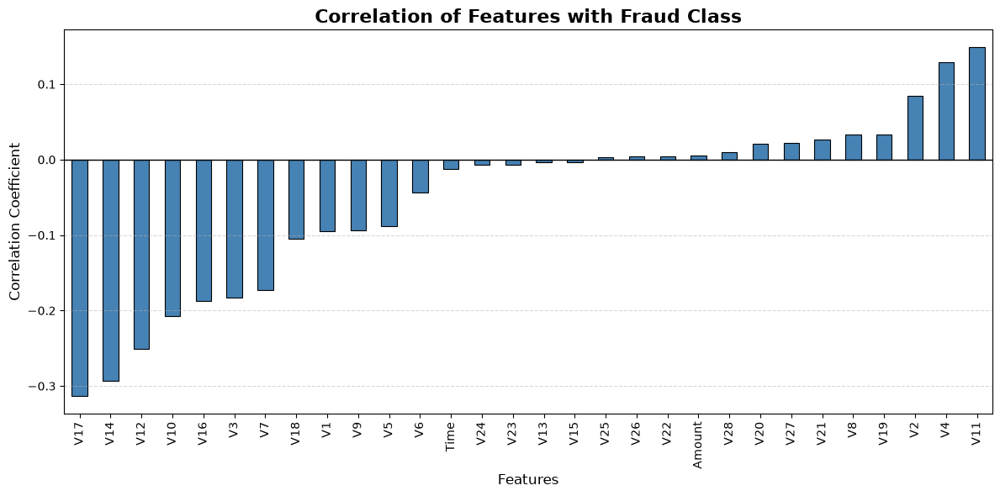

The features most correlated with fraud (absolute value) are **V17 (0.313), V14 (0.293) and V12 (0.251)**.

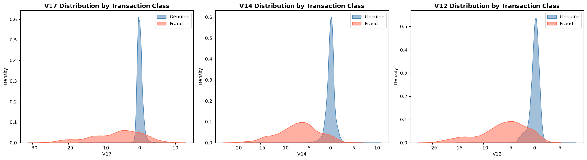

---

## Comparison 1: Undersampling Ratios

Logistic Regression trained on the original data and on four `RandomUnderSampler` ratios (genuine : fraud), evaluated on the same untouched test set (56,746 transactions, 95 fraud).

| Training data | Accuracy | Precision | Recall | F1 | ROC-AUC |
|---|---|---|---|---|---|
| Original | 0.9991 | **0.8485** | 0.5895 | **0.6957** | 0.9563 |
| 20:1 | 0.9985 | 0.5319 | 0.7895 | 0.6356 | **0.9657** |
| 10:1 | 0.9965 | 0.2962 | 0.8105 | 0.4338 | 0.9633 |
| 5:1 | 0.9943 | 0.2052 | 0.8316 | 0.3292 | 0.9587 |
| 1:1 | 0.9731 | 0.0519 | **0.8737** | 0.0980 | 0.9559 |

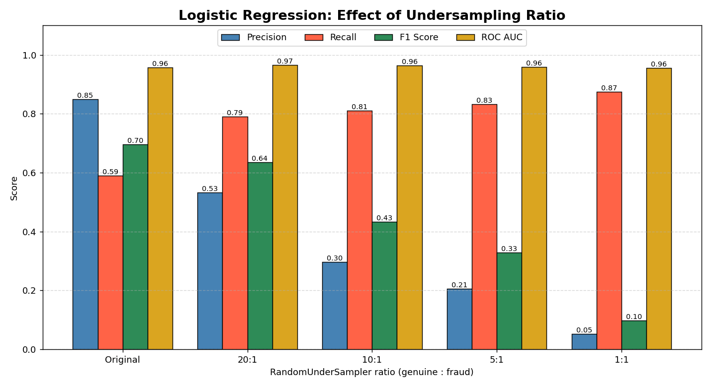

### Confusion matrices
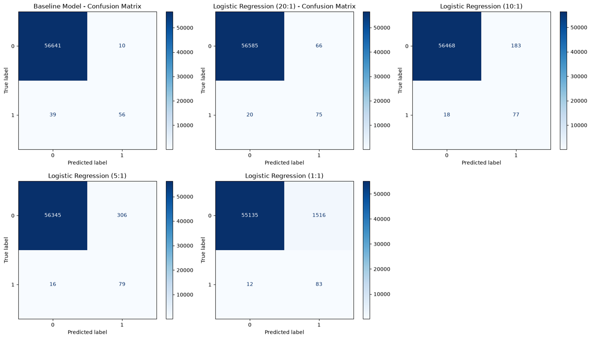

**Takeaway:** pushing towards 1:1 steadily increases recall (59% → 87%) but precision collapses, with 1,516 false alarms at 1:1 versus 66 at 20:1. The **20:1 ratio** was chosen as the best practical trade-off, and it also gave the highest ROC-AUC. It was then used for all model comparisons below.

---

## Comparison 2: Models (20:1 undersampled training data)

| Model | Accuracy | Precision | Recall | F1 | ROC-AUC |
|---|---|---|---|---|---|
| Logistic Regression | 0.9985 | 0.5319 | 0.7895 | 0.6356 | **0.9657** |
| Decision Tree | 0.9916 | 0.1418 | 0.7895 | 0.2404 | 0.8907 |
| Random Forest (100 trees) | **0.9992** | **0.7400** | 0.7789 | **0.7590** | 0.9635 |

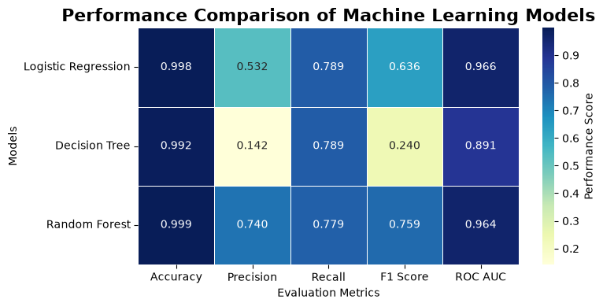

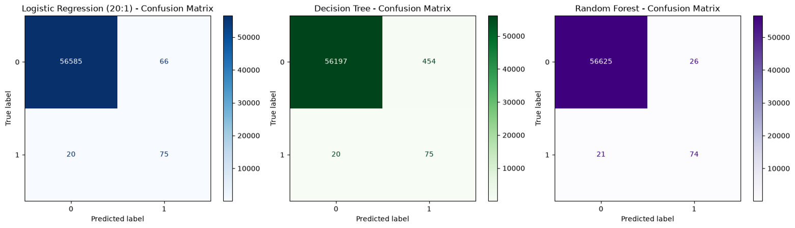

| ROC curves | Precision-Recall curves |
|---|---|
| 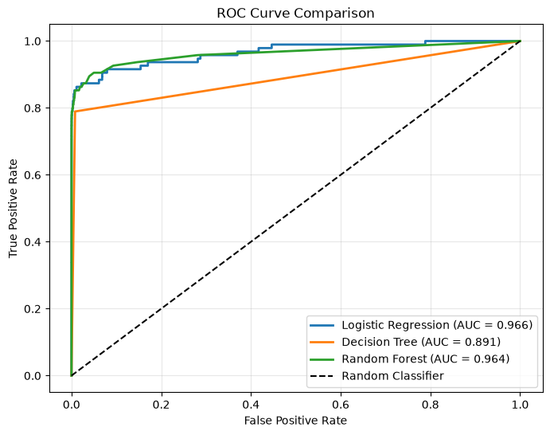 | 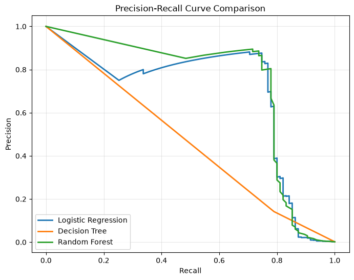 |

### Random Forest feature importance
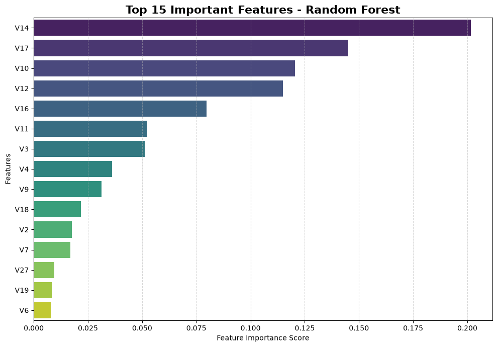

### Result
**Random Forest** was selected as the final model for the best overall balance: highest accuracy, precision and F1, with recall within a point of the other models and ROC-AUC essentially level with Logistic Regression. The Decision Tree gave the weakest precision and ROC-AUC. The forest's important features line up with the EDA (V17, V14, V12).

---

## Repository Structure

```
ccfd/
├── fraud_detection.ipynb     # full analysis and all plots
├── data/
│   └── README.md             # where to download creditcard.csv
├── models/                   # trained models and scalers (Joblib)
│   ├── logistic_regression.pkl
│   ├── decision_tree.pkl
│   ├── random_forest.pkl
│   ├── time_scaler.pkl
│   └── amount_scaler.pkl
├── docs/images/              # plots used in this README
├── scripts/
│   └── plot_ratio_comparison.py
├── requirements.txt
├── LICENSE
└── README.md
```

## How to Run

```bash
git clone <your-repo-url>
cd ccfd
pip install -r requirements.txt
# download creditcard.csv into data/ (see data/README.md)
jupyter notebook fraud_detection.ipynb
```

## Using the Saved Models

```python
import joblib

model = joblib.load("models/random_forest.pkl")
time_scaler = joblib.load("models/time_scaler.pkl")
amount_scaler = joblib.load("models/amount_scaler.pkl")
```

Apply the two scalers to `Time` and `Amount` before calling `model.predict(...)`. Features must be in the original column order (`Time`, `V1`–`V28`, `Amount`).

## Limitations & Future Work

- Single train/test split; the test set has only 95 fraud cases, so metrics can shift noticeably between splits
- No hyperparameter tuning, and the decision threshold was left at the default 0.5
- Future: SMOTE comparison, XGBoost, cross-validation, real-time deployment, a Streamlit dashboard

## Tech Stack

Python, Pandas, NumPy, Matplotlib, Seaborn, Scikit-learn, Imbalanced-learn, Joblib

## License

This project is licensed under the [MIT License](LICENSE).
